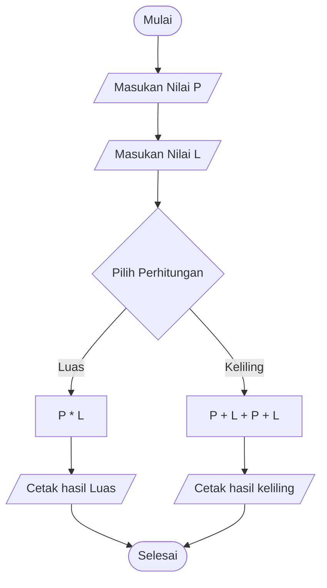

## Menghitung Luas dan keliling persegi panjang
1. Mulai
2. Masukan nilai panjang
3. Masukan nilai luas
4. Bila ingin mencetak luas
5. Maka rumus nya Panjang * Lebar
6. Bila ingin menghitung keliling
7. Maka rumus nya 2 Panjang + 2 Lenar
8. Cetak hasil
9. Selesai

## Flowchart


## Pseudocode
```sh

DECLARE p : INTEGER
DECLARE l : INTEGER
DECLARE luas : REAL
DECLARE keliling : REAL

INPUT p 
INPUT l
luas <-- p * l
keliling <-- p + l + p + l
OUTPUT luas
OUTPUT keliling 

```
