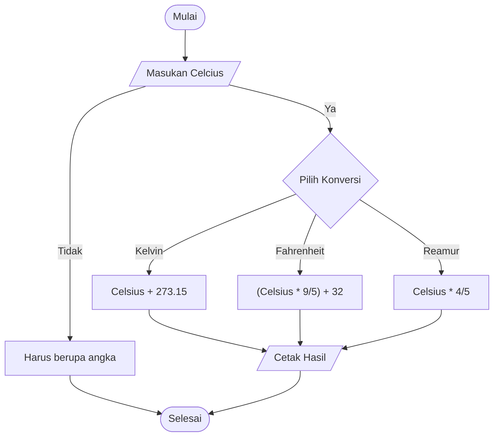

## Algoritma menentukan hasil Konversi
1. Mulai
2. Masukan suhu yang akan di konversi yaitu Celcius
3. Cek dahulu apakah suhu berbentuk angka 
4. Hitung suhu Kelvin dengan rumus Celcius + 273.15
5. Hitung suhu Fahrenheit dengan rumus Celcius * 9/5 + 32
6. HItung suhu Reamour dengan rumus Celcius * 4/5
7. Tampilkan hasil konversi suhu dalam Kelvin,Fahrenheit,Reamur
8. Selesai

## Flowchart Menentukan hasil konversi Suhu

